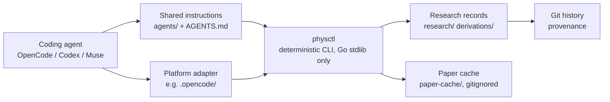

# phys-research

An independent, coding-agent-agnostic physics research system. It connects
published literature, mathematical claims, assumptions, derivations,
hypotheses, and empirical evidence into traceable, inspectable research
records — so a human physicist can verify every step instead of trusting a
summary.

**The system assists scientific investigation; it does not automatically
establish the truth of a physical theory.** No agent operating this system
may declare a hypothesis established. Project policy: scientific acceptance
is a human decision, recorded as a merge into the `accepted` branch
performed by a human (see [AGENTS.md](AGENTS.md)). No protected remote or
other technical enforcement of this boundary is currently in place.

## Why paper summarization is not enough

AI-assisted literature review typically produces fluent prose: what papers
claim, loosely paraphrased, with citations attached. That is insufficient
for serious physics research because it collapses distinctions that matter:

- What the source **asserts** versus what is **derived**, in the source or
  independently.
- The **assumptions, regimes, and effective-theory scales** a result depends
  on.
- Whether a mathematical result from one framework **legitimately transfers**
  to another.
- Which steps are **missing** — and therefore still open obligations rather
  than results.

`phys-research` represents research mathematically and explicitly: equations
with exact source locators, defined variables, separated assumptions per
framework, competing hypotheses with falsification conditions, and unresolved
questions as inspectable `?` obligations. The design objective is that every
research claim and conclusion be traceable to a source, a derivation, or a
clearly marked conjecture; the tooling checks structure, not this property
itself.

## Core principles

- Mathematics is central: physics claims are represented with equations,
  definitions, and derivations, not prose alone.
- Source claims are distinguished from independently reproduced derivations.
  A paper's assertion is never recorded as an independent result.
- Assumptions, physical regimes, and effective-theory scales are explicit
  and tracked per theoretical framework.
- Relationships between frameworks require justified mathematical mappings:
  variable correspondence, equation correspondence, assumption
  reconciliation, and constraint verification.
- Unresolved questions remain explicit `?` obligations, surfaced by tooling.
- Hypotheses stay provisional — proposed or contested — until established
  through the required mathematical and evidential support.
- Human researchers retain scientific acceptance authority. Validation by
  tooling is structural only and never implies correctness.

## Architecture



The research core is a Go CLI plus plain-text records; coding agents are
interchangeable execution environments, not dependencies.

- **`physctl`** (`cmd/physctl`) — deterministic operations: `new` (allocate
  IDs, scaffold records), `status` (open issues, `?` obligations), `refs`
  (reference-graph traversal), `validate` (structural checks), `check`
  (allowlisted external Phys test profiles), `paper` (literature search,
  citation expansion, fetch, extraction), `dist` (distribution payload
  checks). Standard library only; exit codes `0` clean, `1` findings, `2`
  usage/unavailable. Run `go run ./cmd/physctl help` for the full usage.
- **Research artifacts** — Markdown records with restricted frontmatter
  under `research/` (sources, issues, hypotheses, reviews, evidence) and
  `derivations/`. Git history is the provenance store; IDs are allocated by
  `physctl new`, never by hand.
- **Phys-Pseudo** — a seven-construct language for mathematical content:
  `given`, `define`, `assume`, `claim`, `derive`, `if/then/else`, `?`
  (see [AGENTS.md](AGENTS.md) and `agents/researcher.md`). Unresolved `?`
  lines are legitimate obligations, collected by `physctl status`.
- **Paper pipeline** — `paper search` (arXiv + OpenAlex), `paper related`
  (citation/reference expansion), `paper fetch` (open-access PDFs with
  SHA-256 manifests; byte-identity collision rule, never silent
  replacement), `paper extract` (full text via `pdftotext` when available,
  explicit `UNAVAILABLE` otherwise). Downloads are untrusted input.
- **Validation and cross-references** — `physctl validate` enforces record
  schemas, closed vocabularies (states, priorities, branches, six relation
  types), claim locators, and review freshness (a review goes stale when
  its target or material inputs change). `physctl refs` walks the graph.
- **Agent instructions and adapters** — platform-neutral role methodology
  lives in `agents/`; `.opencode/` holds only OpenCode execution config
  (model pins, permission syntax). The contract all agents implement is
  [docs/AGENT_CONTRACT.md](docs/AGENT_CONTRACT.md).

## Coding-agent compatibility

The research core vendors nothing: any agent that can read repository files
and execute the Go CLI can operate it. Mandatory core capabilities are:
read instructions, read/write artifacts in the assigned workspace, run
`physctl`, follow the methodology and integrity rules, maintain
traceability, and respect human acceptance. Optional integrations — web
search, PDF inspection, parallel subagents, MCP — must never become hidden
requirements; without them the agent works from cached full texts and says
so. Full contract: [docs/AGENT_CONTRACT.md](docs/AGENT_CONTRACT.md).

Actual status (source of truth:
[docs/compatibility-matrix.md](docs/compatibility-matrix.md), 2026-11-05):

| Capability | Muse | Codex | OpenCode |
| ---------- | ---- | ----- | -------- |
| Core workflow (instructions, physctl, create, validate, provenance) | VERIFIED | NOT VERIFIED | NOT VERIFIED |
| Literature discovery (live search) | VERIFIED | NOT VERIFIED | NOT VERIFIED |
| Complete Researcher workflow | VERIFIED | NOT VERIFIED | NOT VERIFIED |

The Muse column reflects an interactive-session fixture run plus execution
of the full Branch C program in this repository. Codex and OpenCode runs
were discontinued before any model call; no compatibility is claimed for
them. Do not advertise cross-platform support beyond this table.

## Research artifact model

Six record types, each with a fixed directory and ID namespace:

| Type | Directory | Purpose |
| ---- | --------- | ------- |
| source | `research/sources` | A paper: bibliographic identity, SHA-256 of the exact PDF examined, claims with locators |
| issue | `research/issues` | An open research question: theoretical vs experimental expectations |
| hypothesis | `research/hypotheses` | A physical (`class: physical`, with falsification condition) or mathematical claim |
| review | `research/reviews` | Adversarial challenge of one hypothesis; append-only, goes stale on change |
| evidence | `research/evidence` | Measured values with units, uncertainties, and methodology |
| derivation | `derivations` | Premises, dependencies, intermediate results, rules, obligations |

References use a closed vocabulary: `motivated_by`, `supports`,
`challenges`, `addresses`, `depends_on`, `supersedes`. A real example from
Branch C: source [P-006](research/sources/P-006.md) (semiclassical
Einstein–Cartan paper) motivates issue [I-002](research/issues/I-002.md);
hypothesis [H-003](research/hypotheses/H-003.md) is motivated by I-002 and
challenges [H-002](research/hypotheses/H-002.md); evidence
[E-002](research/evidence/E-002.md) addresses both hypotheses; derivation
[D-001](derivations/D-001.md) compares the frameworks and holds the shared
obligations O1–O7, which also appear as `?` lines in H-002 and surface in
`physctl status`.

## Current research demonstration: Branch C

Question: *Can classical Riemann–Cartan geometry be consistently coupled
to quantum matter without quantizing spacetime, and what mathematical
conditions must such a theory satisfy?*

Three frameworks are investigated separately, with no presumed transfer
between them:

1. Semiclassical Einstein–Cartan gravity.
2. Stochastic or hybrid classical–quantum Einstein–Cartan dynamics.
3. Quantum Einstein–Cartan gravity.

The investigation (index: [docs/dossier-branch-c.md](docs/dossier-branch-c.md))
comprises a qualified literature map (one foundational, four directly
relevant, one related, one tangential source), load-bearing equations with
exact locators, a framework comparison with explicit transfer mappings
(D-001), two competing hypotheses (H-002's stochastic-hybrid proposal vs
H-003's semiclassical-sufficiency null, distinguished by obligations O3 and
O5/O6), and ten open `?` obligations: O1–O7 under H-002 plus three
competition-settling questions under H-003. **The dossier has not
independently reproduced its load-bearing derivations** — all mathematics is
source-reported or conjectured, and the dossier says so. This is a
traceable investigation in progress, not a proven theory or completed
result.

## Getting started

Prerequisites: Go 1.25.7 or newer (per `go.mod`; standard library only, no
dependencies to install). Optional: `pdftotext` (poppler) for PDF text
extraction; network access for paper search and fetching.

```sh
git clone https://github.com/PithomLabs/phys-research
cd phys-research
go build ./...
go run ./cmd/physctl validate
go test ./...
```

Useful entry points:

- `go run ./cmd/physctl help` — full command usage.
- `go run ./cmd/physctl status` — open issues and `?` obligations.
- `go run ./cmd/physctl refs I-002 --in --depth 2` — reference graph.
- `go vet ./...` — static checks.

`physctl check` runs allowlisted external Phys test profiles and requires
a local, untracked `go.work` (see [AGENTS.md](AGENTS.md) §10); without it
the command reports `UNAVAILABLE`, never a pass.

## Working with a coding agent

1. Choose an environment whose compatibility is actually verified (see the
   matrix above).
2. Read [AGENTS.md](AGENTS.md), `agents/researcher.md`, and
   [docs/AGENT_CONTRACT.md](docs/AGENT_CONTRACT.md) first.
3. Work in a dedicated Git worktree and branch per agent session; launch
   the agent with that worktree as its working directory. Never run two
   agents in the same checkout.
4. Establish a unique agent/run identity; proposed revisions go to
   `research/proposed/<agent-id>/<run-id>/<artifact-path>` (run-IDs are
   never reused).
5. Execute the Researcher workflow (literature → claims with locators →
   issues → hypotheses → evidence), creating canonical records only via
   `physctl new` and validating with `physctl validate`. Revisions to
   existing records go to `research/proposed/` as proposed versions, never
   as in-place rewrites.
6. Never overwrite another agent's outputs; conflicting work is preserved
   for human merge resolution.
7. Submit work for human integration and review; per project policy,
   acceptance is a human-performed merge into `accepted`.

Worktree separation is an operational safeguard, not OS-level filesystem
isolation — it prevents accidental collisions, not a process deliberately
writing outside its checkout. New worktrees do not include uncommitted
changes from the main checkout. Baseline distribution to agent workspaces
follows the staged, verified procedure in
[docs/AGENT_CONTRACT.md](docs/AGENT_CONTRACT.md) (fresh staging worktree,
validated payload, human designation) — follow that document rather than
any summary here.

## Development and contribution

Repository layout: `cmd/physctl` (CLI), `internal/` (record, validate,
refs, status, store, paper, check, frontmatter, distrib), `research/`
(records), `derivations/`, `agents/` (canonical role instructions),
`.opencode/` (OpenCode adapter), `docs/`, `hooks/` (convenience guards).

- Add canonical artifacts with `physctl new` (IDs, scaffolds, create-only
  writes); never hand-write IDs or digests. Proposed revisions live
  separately under `research/proposed/` for human promotion.
- Validate with `physctl validate` and keep the suite green (`go test
  ./...`); static gate is `go vet ./...`.
- Preserve provenance: exact source locators on every claim, SHA-256 of
  examined files, `refs` edges for every dependency.
- Revise by proposing: canonical records are never rewritten in place to
  change their meaning — write proposed versions under
  `research/proposed/<agent-id>/<run-id>/` for human promotion.
- Retain competing hypotheses and derivations side by side; use
  `challenges` relations and falsification conditions rather than deleting
  alternatives.

## Current limitations

Implemented and tested: record lifecycle, structural validation,
reference graph, `?` obligation tracking, paper search/fetch/extract with
collision-safe caching, payload checks, worktree separation, and the staged
baseline distribution procedure (verified end-to-end on a staging worktree).
Concurrent multi-agent operation is safeguarded by these mechanisms, not
technically enforced: nothing prevents a process with unrestricted
filesystem access from writing outside its assigned worktree.

Not implemented — do not assume otherwise:

- No autonomous theorem proving and no independent mathematical
  verification: `validate` is structural; `check` runs only allowlisted
  external tests.
- No experimental evaluation: evidence records transcribe published
  measurements; the system performs no experiments.
- No OS-level multi-agent isolation: worktrees plus create-only operations
  are safeguards, not a security boundary.
- Codex and OpenCode operation is unverified (see matrix).
- The Branch C dossier's mathematics is source-reported, not independently
  reproduced; obligations O1–O7 and H-003's three questions remain open.

## License and citation

Licensed under the MIT License — see [LICENSE](LICENSE) (© 2026 Pithom
Labs). There is currently no citation file, DOI, or formal publication
record for this project; none is claimed.
